  
    
  <strong>Building useful software, from the database to the screen.</strong>
   
  Full-stack developer in Dhaka, Bangladesh
    
  <a href="https://github.com/arifulhaquerohan?tab=repositories">Projects</a> &nbsp;·&nbsp;
  <a href="mailto:arifulhaquerohan@gmail.com">Email</a>

### About me

I'm Rohan, a developer at Bangla Sketch with a background in CSE at BUBT. I build APIs and interfaces for real-world workflows, and explore machine learning with local data.

**My stack:** Python · Django · PostgreSQL · React · Next.js

### Selected projects

- **[FlatLand BD](https://github.com/arifulhaquerohan/FlatLand-BD)** — A real estate marketplace for Bangladesh, with property listings and interior design studios.
- **[Weather Prediction Model](https://github.com/arifulhaquerohan/Weather-Prediction-Model)** — Rainfall prediction using Bangladesh weather data, with understandable risk explanations.
- **[BUBT Club Management](https://github.com/arifulhaquerohan/BUBT-Club-Management-System)** — A Flask app for club information, registrations, and admin approvals.

 

  <a href="mailto:arifulhaquerohan@gmail.com">Let's build something useful together ↗</a>

