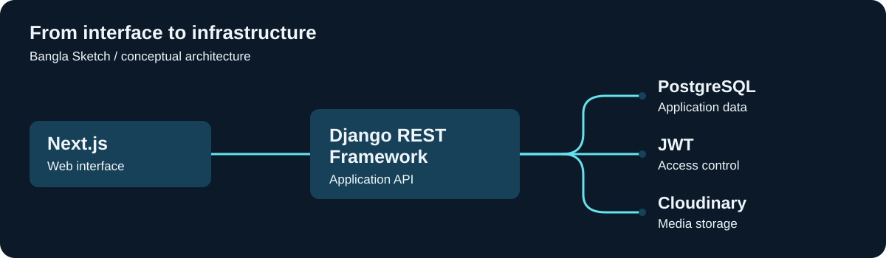

  
    
  
<strong>Full-stack developer in Dhaka, building business applications with Django, PostgreSQL, and Next.js.</strong>

  <a href="https://github.com/arifulhaquerohan?tab=repositories"><strong>Explore my code ↗</strong></a>
  &nbsp;&nbsp; / &nbsp;&nbsp;
  <a href="mailto:arifulhaquerohan@gmail.com"><strong>Get in touch ↗</strong></a>

 

### About

I'm **Ariful Haque Rohan**. I build the APIs, data models, and interfaces that turn business workflows into usable software. My main tools are **Python, Django, PostgreSQL, React, and Next.js**.

I also explore practical machine learning with local data, including weather patterns in Bangladesh.

**Experience** &nbsp; Developer at Bangla Sketch · since 2025  
**Education** &nbsp; B.Sc. in Computer Science & Engineering · BUBT

 

### Selected projects

#### Bangla Sketch
**Business software for an interior design workflow.**

An application for project tracking, admin and client access, and media management in an interior design business.

**My contributions**

- REST endpoints and database models supporting the application workflows.
- Frontend interfaces for interacting with project information.
- Integrations connecting the application with external services.

**System overview**

**Next.js · Django REST Framework · PostgreSQL · Cloudinary**

---

#### Weather prediction in Bangladesh
**Exploring weather patterns through machine learning.**

A study of **3,271 weather records from 2013–2022**, covering rainfall classification and temperature regression. It brings together data preparation, model experimentation, and analysis with Python.

**Python · scikit-learn · pandas · PostgreSQL**

---

#### Small tools, practical problems

| Project | Focus |
| :--- | :--- |
| [**Text File Translator ↗**](https://github.com/arifulhaquerohan/text-file-translator) | Text-file translation |
| [**Image to PDF ↗**](https://github.com/arifulhaquerohan/image_to_pdf_flutter_app) | Image-to-PDF conversion with Flutter |

 

### Approach

**Understand the workflow → Model the data → Connect the API → Make it usable**

From a database relationship to the screen it powers, I care about how the pieces work together. My projects connect backend engineering, usable interfaces, and practical problems.

 

### Tech stack

| Layer | Tools |
| :--- | :--- |
| **APIs & backend** | Python · Django · Django REST Framework |
| **Data & storage** | PostgreSQL · SQL · database design |
| **Web interfaces** | JavaScript · React · Next.js · Tailwind CSS |
| **Development** | Git · Docker · Linux · Cloudinary |
| **Exploration** | C++ · scikit-learn · pandas |

 

### Contact

Have a project involving backend systems, a full-stack product, or an interesting dataset? I'd be glad to talk.

**[arifulhaquerohan@gmail.com ↗](mailto:arifulhaquerohan@gmail.com)**

 

